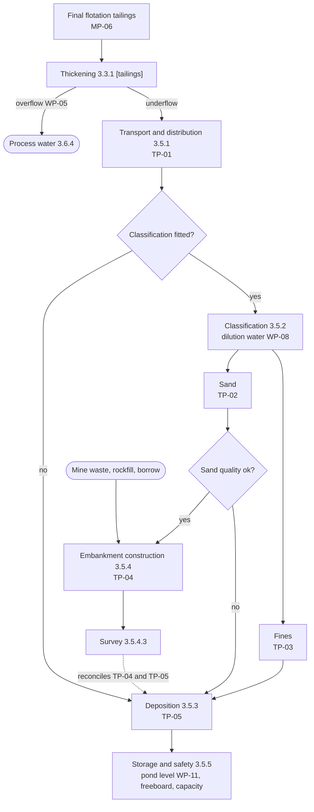
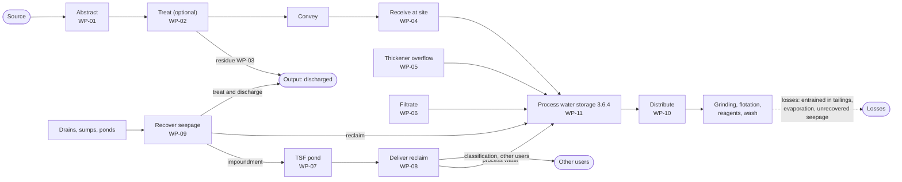

# Process Model Reference — Water-and-Tailings
# Scoped entity extract from Teck Process Models.
# Generated: 2026-10-26
# Source pillar(s): Pillar 3 — Processing & Beneficiation (pillar-models/03-processing-and-beneficiation.md)
# Process areas in scope: 3.3.1 Thickening (tailings duty), 3.5 Tailings Management, 3.6 Water Management
# This file is the foundation for the BEAM workshop — read at workshop start.
# Do not modify manually — regenerate via `extract entities for Water-and-Tailings`.

---

## Product Scope

**Product name:** Water-and-Tailings
**DDVC layer:** curated
**Product purpose:** Canonical tailings deposition, embankment construction, facility storage and water transfer data supporting operational reporting on water and tailings.
**Sites in scope:** QB
**Primary site:** QB
**Generic intent:** QB is the first site, not the only one. The model is generic and must serve any site running the same Pillar 3 patterns (tailings facility, water systems). A site whose process differs is modelled generically when it arrives, as configuration or a pillar addition (LL-005, LL-006). QB specifics live in the overlay and in `process-configuration.draft.yaml`, never in entity or process names.

**Scope decisions confirmed by the analyst (2026-10-26):**
- Curated layer, QB first, generic by design.
- `process_node` is **not** owned here. Unit-operation nodes are a view onto `functional_location` (shared asset backbone, see Cross-Pillar Dependencies); measurement-point nodes are `measurement_point`. See LL-021.
- `amira_measurement_point` is excluded. MP-06 (tailings thickener feed, the tailings term of the plant mass balance) is carried as a cross-reference on `measurement_point`, so metal accounting stays out of this product.
- No custom (Teck-specific) entities. Collahuasi allocation sits on `water_system.shared_with`; Fine Sands, Bench, Prism and Lagoon are vocabulary and configuration items for the workshop.
- KPIs and metrics are out of scope (Stage 2 / Contextualized): the 38 reporting metrics, Availability, MTBF, MTTR, Total Concentrator Water, RWS Recycle per Ton.

**Process groups in scope:**

| Pillar ID | Group | Scope note |
|-----------|-------|------------|
| 3.3.1 | Thickening | Tailings duty only (feed to 3.5, overflow to 3.6.4) |
| 3.5.1 to 3.5.5 | Tailings Management | All five groups |
| 3.6.1 to 3.6.5 | Water Management | All five groups |
| 3.3.1 (concentrate duties), 3.3.2.4 | Concentrate thickening, filtrate recovery | Out of scope as processes. Their recovered water enters only as `water_transfer_record` rows (WP-05, WP-06), and a remote (port) filtration location is its own `water_system`. |

---

## Entity Summary

| Entity Name | Type | DDVC Layer | Grain | Source System(s) | Pillar Ref |
|-------------|------|------------|-------|------------------|------------|
| `tailings_facility` | Master | curated | One row per facility (versioned on configuration change) | Facility design and configuration records; survey system; geotechnical monitoring system | 3.5 (Entity Catalog, Master) |
| `facility_location` | Master | curated | One row per location | Survey system; DCS / SCADA; facility construction records | 3.5 (Entity Catalog, Master) |
| `water_system` | Master | curated | One row per system per site (versioned on configuration change) | Water supply SCADA; DCS / SCADA; water balance model | 3.6 (Entity Catalog, Master) |
| `measurement_point` | Reference | curated | One row per role per instance | DCS / SCADA; PI Historian (instrument tags unverified at QB) | 3.3.1, 3.5, 3.6 (Entity Catalog, Reference) |
| `tailings_deposition_record` | Transactional | curated | One row per period per stream per location | DCS / SCADA; PI Historian; survey system | 3.5.3 (Entity Catalog, Transactional) |
| `construction_placement_record` | Transactional | curated | One row per period per location per material | Construction records; DCS / SCADA (hydraulic placement); FMS (mine waste) | 3.5.4 (Entity Catalog, Transactional) |
| `facility_survey_record` | Transactional | curated | One row per survey per zone | Survey system | 3.5.4.3 (Entity Catalog, Transactional) |
| `tsf_inventory_record` | Transactional | curated | One row per facility per assessment date | Survey system; PI Historian; facility planning model | 3.5.5 (Entity Catalog, Transactional) |
| `facility_operating_constraint` | Event | curated | One row per constraint issued | Geotechnical monitoring system; incident / risk system | 3.5.5.3 (Entity Catalog, Event) |
| `water_transfer_record` | Transactional | curated | One row per period per source system per destination system | PI Historian; DCS / SCADA; water balance model | 3.6 (Entity Catalog, Transactional) |
| `water_balance_record` | Transactional | curated | One row per system per period | Water balance model; PI Historian | 3.6.5 (Entity Catalog, Transactional) |

Source systems are taken from the process rows of 3.3.1, 3.5 and 3.6, because the Pillar 3 entity catalog has no source-system column. They are workshop questions, not confirmed facts for QB.

**11 entities:** 3 Master, 1 Reference, 6 Transactional, 1 Event.

---

## Entity Catalog (Full Extract)

### tailings_facility

> *Extracted from pillar-models/03-processing-and-beneficiation.md, Entity Catalog*

**Entity Type:** Master
**Business Definition:** A Tailings Storage Facility (TSF) and its configuration: deposition method, construction method and materials, whether classification is fitted, and its operating criteria. The configuration record for Tailings Management (3.5) — the process groups are the same for every facility.
**Grain:** One row per facility (versioned on configuration change)
**Key Attributes:** `facility_id`, `site_id`, `facility_name`, `deposition_method` (conventional / thickened / paste), `construction_method` (upstream / centreline / downstream), `construction_materials` (classified_sand / mine_waste / rockfill / borrow), `classification_fitted_flag`, `freeboard_criterion_m`, `consequence_classification`, `effective_from`, `effective_to`
**Lifecycle / State Transitions:** Design → Operating → Closure → Post-closure
**Key Relationships:** HAS `facility_location`; HAS `process_node` (pumps, classifiers, pond instruments); RECEIVES `tailings_deposition_record`; ASSESSED IN `tsf_inventory_record`
**Scope note (LL-022, for review):** `process_node` is not owned by this product. Read "HAS `process_node`" as: the facility is itself a `functional_location` node (D1); its pumps and classifiers are descendant `functional_location`s; its pond instruments are `measurement_point`s anchored to the FLoc (D1-02). The Pillar 3 text above is verbatim and unchanged.
**Source System(s):** Facility design and configuration records; survey system; geotechnical monitoring system *(from process rows; not in the catalog)*
**Standard Alignment:** GISTM (2020); ICMM tailings governance
**DDVC Layer:** curated

### facility_location

> *Extracted from pillar-models/03-processing-and-beneficiation.md, Entity Catalog*

**Entity Type:** Master
**Business Definition:** A place in a tailings facility where material is deposited, placed or stored: impoundment or cell, construction cell or paddock, embankment zone, pond, seepage pond or sump.
**Grain:** One row per location
**Key Attributes:** `location_id`, `facility_id`, `location_name`, `location_type` (impoundment / cell / paddock / embankment_zone / pond / seepage_pond / sump), `parent_location_id`, `status` (active / resting / closed)
**Lifecycle / State Transitions:** Planned → Active → Resting → Closed
**Key Relationships:** PART OF `tailings_facility`; RECEIVES `tailings_deposition_record`, `construction_placement_record`; SURVEYED IN `facility_survey_record`
**Source System(s):** Survey system; DCS / SCADA; facility construction records *(from process rows; not in the catalog)*
**Standard Alignment:** GISTM
**DDVC Layer:** curated

### water_system

> *Extracted from pillar-models/03-processing-and-beneficiation.md, Entity Catalog*

**Entity Type:** Master
**Business Definition:** A water supply, recovery, storage or use system with its own accounting boundary: makeup supply (with its source type and treatment), process water, reclaim, seepage collection, tailings facility water, or a remote location's water system (e.g., at a port). Carries any shared-supply allocation.
**Grain:** One row per system per site (versioned on configuration change)
**Key Attributes:** `system_id`, `site_id`, `system_name`, `system_type` (makeup_supply / process_water / reclaim / seepage_collection / facility_water / remote), `source_type` (seawater / surface / groundwater / third_party, for makeup supply), `treatment_type`, `boundary_description`, `shared_with`, `effective_from`, `effective_to`
**Lifecycle / State Transitions:** Active → Modified → Decommissioned
**Key Relationships:** CONTAINS `process_node`; SOURCE / DESTINATION OF `water_transfer_record`; BALANCED IN `water_balance_record`
**Scope note (LL-022, for review):** `process_node` is not owned by this product. A water system is an accounting boundary, not a branch of the FLoc hierarchy: it can cut across areas (seepage collection, shared supply). Read "CONTAINS `process_node`" as an effective-dated, many-to-many **membership** between `water_system` and `functional_location` (pumps, tanks, meters), not a parent-child level. Whether that membership needs its own entity is a workshop question (see Workshop Question Inventory, WQ-W1). The Pillar 3 text above is verbatim and unchanged.
**Source System(s):** Water supply SCADA; DCS / SCADA; water balance model *(from process rows; not in the catalog)*
**Standard Alignment:** MCA Water Accounting Framework
**DDVC Layer:** curated

### measurement_point

> *Extracted from pillar-models/03-processing-and-beneficiation.md, Entity Catalog*

**Entity Type:** Reference
**Business Definition:** A designated tailings or water measurement position (roles TP-01 to TP-05, WP-01 to WP-11), instantiated per stream, user or destination, with its instrument and validation status. Complements `amira_measurement_point`, which holds the P754 metal accounting roles.
**Grain:** One row per role per instance
**Key Attributes:** `mp_id`, `mp_role`, `instance_ref` (thickener duty, user, destination, store), `stream_description`, `measurement_type` (flow / volume / level / density / survey_volume), `method`, `frequency`, `instrument_tag`, `boundary_flag`, `validation_status` (candidate / confirmed)
**Lifecycle / State Transitions:** Candidate → Confirmed → Updated (instrument change)
**Key Relationships:** LINKED TO `process_node`; MEASURES transfers in `water_transfer_record` and `tailings_deposition_record`; PRODUCES `process_measurement_telemetry`
**Scope note (LL-022, for review):** `process_node` is not owned by this product. Read "LINKED TO `process_node`" as: ANCHORED TO `functional_location` (D1-02), so measurement survives equipment swaps. A designated TP/WP role is confirmed by linking it to a tag-backed measurement point; the two concepts need distinct names (LL-021). Telemetry (`process_measurement_telemetry`) is Capture-layer and out of scope. The Pillar 3 text above is verbatim and unchanged.
**Source System(s):** DCS / SCADA; PI Historian (instrument tags unverified at QB) *(from process rows; not in the catalog)*
**Standard Alignment:** MCA WAF; AMIRA P754 Principles 1, 7, 8
**DDVC Layer:** curated

### tailings_deposition_record

> *Extracted from pillar-models/03-processing-and-beneficiation.md, Entity Catalog*

**Entity Type:** Transactional
**Business Definition:** The tailings (or classification fines, or rejected sand) delivered to the facility and deposited at a location in a period, with its measurement basis. Separates tailings generated at the plant (MP-06) from tailings deposited at the facility (TP-05).
**Grain:** One row per period per stream per location
**Key Attributes:** `record_id`, `period_id`, `facility_id`, `location_id`, `stream` (tailings / fines / rejected_sand), `dry_tonnes`, `volume_m3`, `pct_solids`, `measurement_basis` (metered / by_difference / survey), `mp_id`
**Lifecycle / State Transitions:** Provisional (period end) → Reconciled (survey) → Final
**Key Relationships:** AT `facility_location`; MEASURED AT `measurement_point`; FEEDS `tsf_inventory_record`
**Source System(s):** DCS / SCADA; PI Historian; survey system *(from process rows; not in the catalog)*
**Standard Alignment:** GISTM; AMIRA P754 Principles 1, 7
**DDVC Layer:** curated

### construction_placement_record

> *Extracted from pillar-models/03-processing-and-beneficiation.md, Entity Catalog*

**Entity Type:** Transactional
**Business Definition:** Construction material placed in the embankment in a period, by location and material type (classified sand, mine waste, rockfill, borrow), with quality and compaction results. Separates sand produced (TP-02) from sand placed (TP-04).
**Grain:** One row per period per location per material
**Key Attributes:** `record_id`, `period_id`, `location_id`, `material_type`, `quantity_t`, `volume_m3`, `fines_pct`, `compaction_result`, `measurement_basis`
**Lifecycle / State Transitions:** Placed → Drained / compacted → Surveyed
**Key Relationships:** AT `facility_location`; RECONCILED BY `facility_survey_record`
**Source System(s):** Construction records; DCS / SCADA (hydraulic placement); FMS (mine waste) *(from process rows; not in the catalog)*
**Standard Alignment:** GISTM
**DDVC Layer:** curated

### facility_survey_record

> *Extracted from pillar-models/03-processing-and-beneficiation.md, Entity Catalog*

**Entity Type:** Transactional
**Business Definition:** A survey of a tailings facility giving volumes and geometry by zone (embankment zones, beach, pond) and crest elevation, compared with the previous survey and the design.
**Grain:** One row per survey per zone
**Key Attributes:** `survey_id`, `survey_date`, `method`, `location_id`, `volume_m3`, `volume_change_m3`, `crest_elevation_m`, `pond_area_m2`, `pond_volume_m3`, `beach_width_m`
**Lifecycle / State Transitions:** Captured → Processed → Approved
**Key Relationships:** SURVEYS `facility_location`; FEEDS `tsf_inventory_record`
**Source System(s):** Survey system *(from process rows; not in the catalog)*
**Standard Alignment:** GISTM; AMIRA P754 Principle 3
**DDVC Layer:** curated

### tsf_inventory_record

> *Extracted from pillar-models/03-processing-and-beneficiation.md, Entity Catalog*

**Entity Type:** Transactional
**Business Definition:** A tailings facility's storage position at an assessment date: deposited tailings, pond water inventory, freeboard and available capacity against criteria.
**Grain:** One row per facility per assessment date
**Key Attributes:** `inventory_id`, `facility_id`, `assessment_date`, `deposited_tailings_t`, `pond_volume_m3`, `pond_level_masl`, `freeboard_m`, `freeboard_criterion_m`, `available_capacity_m3`, `capacity_status`
**Lifecycle / State Transitions:** Draft → Reviewed → Approved
**Key Relationships:** OF `tailings_facility`; AGGREGATES `tailings_deposition_record`, `facility_survey_record`; MAY RAISE `facility_operating_constraint`
**Source System(s):** Survey system; PI Historian; facility planning model *(from process rows; not in the catalog)*
**Standard Alignment:** GISTM
**DDVC Layer:** curated

### facility_operating_constraint

> *Extracted from pillar-models/03-processing-and-beneficiation.md, Entity Catalog*

**Entity Type:** Event
**Business Definition:** A constraint issued to the plant or tailings operations when freeboard or capacity is outside operating criteria.
**Grain:** One row per constraint issued
**Key Attributes:** `constraint_id`, `facility_id`, `issued_timestamp`, `trigger` (freeboard / capacity / other), `action_required`, `affected_process`, `lifted_timestamp`
**Lifecycle / State Transitions:** Issued → Active → Lifted
**Key Relationships:** RAISED FROM `tsf_inventory_record`; NOTIFIES Pillar 6 `risk_register_record`
**Source System(s):** Geotechnical monitoring system; incident / risk system *(from process rows; not in the catalog)*
**Standard Alignment:** GISTM; ICMM Fatal Hazard Control
**DDVC Layer:** curated

### water_transfer_record

> *Extracted from pillar-models/03-processing-and-beneficiation.md, Entity Catalog*

**Entity Type:** Transactional
**Business Definition:** The volume of water moved between two water systems, or into or out of the site, in a period, with boundary and allocation attributes that stop the same water being counted twice.
**Grain:** One row per period per source system per destination system
**Key Attributes:** `transfer_id`, `period_id`, `source_system_id`, `destination_system_id`, `volume_m3`, `measurement_basis` (metered / estimated), `mp_id`, `allocation_rule`, `internal_recycle_flag`
**Lifecycle / State Transitions:** Provisional → Allocated → Final
**Key Relationships:** BETWEEN `water_system`; MEASURED AT `measurement_point`; AGGREGATED BY `water_balance_record`
**Source System(s):** PI Historian; DCS / SCADA; water balance model *(from process rows; not in the catalog)*
**Standard Alignment:** MCA WAF; ICMM water reporting guidance
**DDVC Layer:** curated

### water_balance_record

> *Extracted from pillar-models/03-processing-and-beneficiation.md, Entity Catalog*

**Entity Type:** Transactional
**Business Definition:** The closed water balance for one water system, or the site, for one reporting period: inputs, outputs, change in storage, estimated losses and balance error.
**Grain:** One row per system per period
**Key Attributes:** `balance_id`, `period_id`, `system_id`, `inputs_m3`, `outputs_m3`, `storage_change_m3`, `estimated_losses_m3`, `balance_error_m3`, `balance_status` (open / closed / flagged)
**Lifecycle / State Transitions:** Open → Closed → Accepted or Flagged
**Key Relationships:** AGGREGATES `water_transfer_record`; USES `tsf_inventory_record` (pond storage)
**Source System(s):** Water balance model; PI Historian *(from process rows; not in the catalog)*
**Standard Alignment:** MCA WAF; ICMM water reporting guidance
**DDVC Layer:** curated

---

## Process Flow Context

*Extracted from pillar-models/03-processing-and-beneficiation.md, Process Flow Narratives for 3.3 (tailings duty of 3.3.1 only), 3.5 and 3.6, and the tailings and water node maps.*

### 3.3 Dewatering & Product Handling — Process Flow Narrative

**Pool**: Dewatering & Product Handling | **Lanes**: DCS / Auto-control, Control Room Operator / Metallurgist, Plant Operator, Process Technician

**Start Event**: A saleable concentrate or the final tailings stream is available for thickening. The concentrate trains (one per saleable product) and the tailings duty run in parallel; each is an instance of the patterns below.

**L2 sequence:** **3.3.1 Thickening** → *[GATEWAY — Stream type?]* → Tailings: message end "Thickened tailings to tailings management (3.5)". Concentrate (default): **3.3.2 Concentrate Filtration** → *[GATEWAY — Drying or packaging required?]* → Yes: **3.3.3 Concentrate Drying & Packaging**. No: continue → concentrate products handled.

**Thickening (3.3.1)** — one instance per thickener duty (concentrate, bulk concentrate, tailings):
1. **3.3.1.1 Feed Slurry to Thickener** (DCS) — feed flowmeter and densitometer log mass rate continuously (MP-06 for the tailings duty).
2. **3.3.1.2 Dose Flocculant** (DCS + Metallurgist).
3. In parallel:
   - **3.3.1.4 Recover Thickener Overflow Water** (DCS) → recovered water to process water (WP-05).
   - *[GATEWAY — Underflow density below minimum?]* → Yes: **Reduce feed rate or increase flocculant** (narrative-only, Control Room Operator). No: continue. Then **3.3.1.3 Pump Thickener Underflow** (DCS) → underflow to its configured destination.

**Concentrate filtration (3.3.2)** — start "Underflow in filter feed tank":
1. **3.3.2.1 Operate Filter Press or Disc Filter** (DCS Auto-control).
2. In parallel:
   - **3.3.2.4 Recover Filtrate Water** (DCS) → recovered water to process water (WP-06).
   - **3.3.2.2 Discharge Filter Cake** (Plant Operator) → **3.3.2.3 Verify Moisture Content** (Process Technician).
     - *[GATEWAY — Moisture within specification?]* → Yes: **Transfer filter cake to concentrate shed** (narrative-only) → message end "Filter cake to shed (CTP-2)". No: **Adjust filter cycle, wash water or air; check underflow density** (narrative-only) and re-filter (loop to 3.3.2.1).

**Drying and packaging (3.3.3)** — start "Filter cake requires drying or packing":
   - *[GATEWAY — Drying specified?]* → Yes: **3.3.3.1 Dry Concentrate**. No: continue.
   - *[GATEWAY — Packed dispatch specified?]* → Yes: **3.3.3.2 Package and Weigh Concentrate** → message end "Packed units to Logistics (Pillar 4)". No: end "Dried concentrate to storage".

**End Event**: Concentrate products in storage or packed for dispatch; thickened tailings handed to 3.5; recovered water handed to 3.6.

*Only the Thickening (3.3.1) tailings duty is in scope. The concentrate filtration, drying and packaging paragraphs above are context for where recovered water originates.*

### 3.5 Tailings Management — Process Flow Narrative

**Pool**: Tailings Management | **Lanes**: DCS / SCADA, Tailings Operator, Construction Supervisor / Surveyor, Tailings Facility Engineer

**Start Event**: Thickened tailings from thickening (3.3.1, tailings duty).

**L2 sequence:** **3.5.1 Tailings Transport & Distribution** → *[GATEWAY — Classification fitted?]* → Yes: **3.5.2 Tailings Classification**, then in parallel fines to **3.5.3 Tailings Deposition** and sand to **3.5.4 Embankment Construction**. No (default): **3.5.3 Tailings Deposition**. Both lead to **3.5.5 Facility Storage & Safety Monitoring** → facility status and constraints reported.

**Transport and distribution (3.5.1):** message start "Thickened tailings from thickening" → **3.5.1.1 Transport Tailings to Facility** (DCS / SCADA; TP-01).
   - *[GATEWAY — Line pressure or flow abnormal?]* → Yes: **Stop transfer; divert to emergency containment; notify** (narrative-only) → end "Transfer stopped". No (default): **3.5.1.2 Route Tailings to Discharge Point** (Tailings Operator) → end "Tailings at discharge point".

**Classification (3.5.2):** start "Tailings at classification station" → **3.5.2.1 Condition Classifier Feed** → **3.5.2.2 Classify Tailings by Hydrocyclone** (TP-02, TP-03) → in parallel: fines → end "Fines to deposition (3.5.3)"; **3.5.2.3 Verify Sand Quality for Construction**.
   - *[GATEWAY — Sand fit for construction?]* → Yes (default): end "Sand to construction (3.5.4)". No: **Divert sand to deposition** (narrative-only) → end "Rejected sand to deposition".

**Deposition (3.5.3):** start "Tailings at discharge point" → **3.5.3.1 Deposit Tailings in Impoundment** (TP-05) → **3.5.3.2 Manage Beach and Pond Position**.
   - *[GATEWAY — Beach width below minimum?]* → No (default): end "Tailings deposited". Yes: **Relocate discharge to restore beach** (narrative-only) → end "Discharge relocated".

**Embankment construction (3.5.4):** start "Construction material available" → **3.5.4.1 Place Construction Material** (TP-04) → **3.5.4.2 Drain and Compact Placed Material**.
   - *[GATEWAY — Placement meets specification?]* → Yes (default): end "Material placed". No: **Rework non-conforming fill** (narrative-only) → end "Rework recorded".
   - Separate flow: start "Survey scheduled" → **3.5.4.3 Survey Facility Geometry** → message end "Survey results to storage assessment (3.5.5)".

**Storage and safety (3.5.5):** start "Pond reading or survey received" → **3.5.5.1 Monitor Pond Level and Freeboard** (WP-11) → **3.5.5.2 Assess Storage Capacity Against Plan**.
   - *[GATEWAY — Within operating criteria?]* → Yes (default): end "Facility status reported". No: **3.5.5.3 Issue Facility Operating Constraint** → message end "Operating constraint issued".

**End Event**: Tailings stored; facility status and any operating constraints reported.

### 3.6 Water Management — Process Flow Narrative

**Pool**: Water Management | **Lanes**: Water Operator / DCS / SCADA, Tailings Operator, Control Room Operator, Water Balance Analyst

**Start Event**: Site water systems operating. Makeup supply, reclaim and seepage recovery run continuously and in parallel; process water is blended and distributed continuously; the water balance closes each reporting period.

**L2 sequence:** fork → **3.6.1 Makeup Water Supply** ‖ **3.6.2 Reclaim Water** ‖ **3.6.3 Seepage & Drainage Collection** → join → **3.6.4 Process Water Supply & Distribution** → **3.6.5 Site Water Balance & Reconciliation** → period water balance published.

**Makeup water (3.6.1):** start "Makeup water demand" → **3.6.1.1 Abstract Raw Water** (WP-01).
   - *[GATEWAY — Treatment required?]* → Yes: **3.6.1.2 Treat Raw Water** (WP-02) → in parallel **3.6.1.3 Dispose of Treatment Residue** (WP-03) → end "Residue disposed"; and continue. No (default): continue.
   - **3.6.1.4 Convey Makeup Water to Site** → **3.6.1.5 Receive and Store Makeup Water** (WP-04).
   - *[GATEWAY — Transfer volumes reconcile?]* → Yes (default): end "Makeup water in site storage". No: **Investigate transfer loss or meter fault** (narrative-only) → end "Transfer exception logged".

**Reclaim water (3.6.2):** start "Reclaim water demand".
   - *[GATEWAY — Pond above minimum intake level?]* → Yes (default): **3.6.2.1 Reclaim Water from Pond** (WP-07) → **3.6.2.2 Deliver Reclaim Water to Users** (WP-08) → end "Reclaim water delivered to users". No: **Stop reclaim pumping; alert tailings operations** (narrative-only) → end "Reclaim suspended".

**Seepage and drainage (3.6.3):** start "Seepage and drainage flowing" → **3.6.3.1 Collect Seepage and Drainage** (Tailings Operator) → **3.6.3.2 Monitor Collection Ponds and Pumps** (DCS / SCADA).
   - *[GATEWAY — Pond above pump-start level?]* → Yes (default): **3.6.3.3 Pump Recovered Water to Destination** (WP-09) → end "Recovered water at destination". No: end "Water held in pond".

**Process water (3.6.4):** start "Plant water demand" → **3.6.4.1 Blend Water Sources in Process Water Storage** (WP-11).
   - *[GATEWAY — Process water storage below minimum?]* → No (default): continue. Yes: **Increase makeup draw; restrict non-essential use** (narrative-only, Control Room Operator), then continue.
   - **3.6.4.2 Distribute Process Water to Users** (WP-10) → end "Process water delivered".

**Water balance (3.6.5):** start "Reporting period end" → **3.6.5.1 Compile Water Flow and Volume Data** → **3.6.5.2 Apply Water System Boundaries and Allocation Rules** → **3.6.5.3 Close Period Water Balance**.
   - *[GATEWAY — Balance within tolerance?]* → Yes (default): continue. No: **Investigate meters, allocation and storage estimates** (narrative-only, Water Operator), then continue.
   - **3.6.5.4 Publish Water and Tailings Performance Data** → message end "Period data published".

**End Event**: Period water balance published.

### Measurement Point Roles and Node Maps (tailings and water)

#### Tailings and Water Measurement Point Roles

Tailings (TP) and water (WP) points follow the same role-and-instance convention as the P754 roles: `WP-05[tailings thickener]`, `WP-09[to impoundment]`. Tailings mass points are P754-relevant (the TSF closes the plant-side balance); water points follow the Minerals Council of Australia Water Accounting Framework (MCA WAF).

| Role | Stream / quantity | Scope | Measurement Type | Typical method | Boundary? |
|----|--------|-------|-----------------|--------|------|
| TP-01 | Tailings delivered to the facility | Per tailings line | Mass flow + density | Flowmeter + density gauge | Plant–facility boundary |
| TP-02 | Classified sand (classification underflow) | Per classification station | Mass flow + density | Flowmeter + density gauge, or by difference | No |
| TP-03 | Classified fines (classification overflow) | Per classification station | Mass flow + density | Flowmeter + density gauge, or by difference | No |
| TP-04 | Construction material placed | Per placement location and material | Mass or volume | Line flow, truck counts, survey | No |
| TP-05 | Tailings deposited in the impoundment | Per deposition location | Volume and mass | Flow integration, survey | Final sink of the plant balance |
| WP-01 | Raw water abstracted | Per source | Volume | Source meter | **Input** |
| WP-02 | Treated water produced | Per treatment plant | Volume | Product meter | No |
| WP-03 | Treatment residue discharged | Per treatment plant | Volume | Flow meter | **Output** |
| WP-04 | Makeup water received at site | Per supply system | Volume | Receipt meter | Site boundary |
| WP-05 | Thickener overflow recovered | Per thickener duty | Volume | Overflow flow meter | Internal recycle |
| WP-06 | Filtrate recovered | Per filtration train | Volume | Flow meter | Internal recycle, or a remote location's boundary |
| WP-07 | Reclaim water pumped from the pond | Per reclaim system | Volume | Reclaim line meter | Internal recycle |
| WP-08 | Reclaim water delivered | Per user | Volume | Flow meter per user | Internal recycle |
| WP-09 | Seepage and drainage recovered | Per destination | Volume | Pump flow meters | Internal recycle, or output if discharged |
| WP-10 | Process water distributed | Per user | Volume | Flow meters | No |
| WP-11 | Storage inventory (pond, tanks) | Per store | Level and volume | Level sensor + survey or bathymetry | Storage change |

#### Node Map: Tailings (patterns 3.3.1 and 3.5)

Tailings identity (per period, dry solids):
- MP-06 = TP-01 + change in thickener inventory
- TP-01 = TP-02 + TP-03 (where classification is fitted)
- TP-02 = TP-04 (sand) + rejected sand + change in cell inventory
- Survey (3.5.4.3) reconciles TP-04 and TP-05.

#### Node Map: Water Systems (pattern 3.6)

Water balance (per system, per period): `inputs - outputs - change in storage = balance error`. Internal recycles (WP-05 to WP-09) are flows inside the site and are counted once, never as inputs.

---

## SIPOC Reference

*Extracted from pillar-models/03-processing-and-beneficiation.md, SIPOC Artifacts 3.5 and 3.6.*

### SIPOC 3.5 — Tailings Management

| Element | Content |
|---------|---------|
| **Suppliers** | Thickening (3.3.1, tailings duty) — thickened tailings; Water Management (3.6) — dilution water; Mining Operations (Pillar 2) or borrow sources — construction material where not tailings sand; Facility design — deposition and construction plans, operating criteria |
| **Inputs** | Thickened tailings; dilution water; construction material; deposition plan; construction plan; freeboard and capacity criteria |
| **Process** | Transport tailings to the facility; classify into sand and fines where fitted; deposit tailings in the impoundment and manage beach and pond; place and compact construction material and survey the facility; monitor pond level, freeboard and capacity and issue operating constraints |
| **Outputs** | Tailings deposited; embankment raised; placement, deposition and survey records; pond inventory; freeboard and capacity status; operating constraints; drainage to seepage collection; pond water available for reclaim |
| **Customers** | Water Management (3.6) — pond inventory, drainage, reclaim source; Metallurgical Accounting (3.4) — tailings term of the plant balance; Plant operations — operating constraints; Health & Safety (Pillar 6) — facility status and exceptions; Regulators — facility reporting (out of scope as a domain) |

### SIPOC 3.6 — Water Management

| Element | Content |
|---------|---------|
| **Suppliers** | Water source (seawater, surface water, groundwater, third-party supply); Dewatering & Product Handling (3.3) — recovered overflow and filtrate; Tailings Management (3.5) — TSF pond, seepage and drainage; Mining Operations (Pillar 2) — mine dewatering water at the site boundary; Maintenance & Reliability (Pillar 5) — water asset availability |
| **Inputs** | Raw water; treatment chemicals and energy; recovered water; pond water; seepage and drainage; meter readings; storage surveys; boundary and allocation rules |
| **Process** | Abstract, treat (where required), convey and receive makeup water; reclaim pond water and deliver it to users; collect and recover seepage and drainage; blend and distribute process water; compile, allocate and close the periodic water balance |
| **Outputs** | Makeup water received; treatment residue discharged; reclaim and recovered water delivered; process water distributed; water balance by system and period; published water and tailings data |
| **Customers** | Plant (3.1, 3.2) — process water; Tailings Management (3.5) — dilution water; Operational reporting; Environment and permitting (out of scope as a domain); Maintenance & Reliability (Pillar 5) — water asset run and fault data |

---

## Cross-Pillar Dependencies

Entities and capabilities referenced but not owned by this product. **Class** tells you what each one blocks, so work on it can be started and tracked in its own right.

- **BLOCKER (design)**: needs a decision or contract before Stage 2 can finalise this product's logical model.
- **BLOCKER (load)**: does not stop design; must exist before data can be loaded or populated.
- **BLOCKER (Release 2)**: does not stop Release 1; blocks the reliability KPIs only.
- **NON-BLOCKING**: interface by contract; the link stays nullable until the other side exists.

| # | Dependency | Owned by | How this product uses it | Class | Work to initiate |
|---|------------|----------|--------------------------|-------|------------------|
| D1 | `functional_location`, `equipment`, `equipment_installation` (shared asset backbone) | **No owner yet.** Candidate stewards: Pillar 5 (SAP PM) or a standalone shared reference product. Mill-Curated (HVC) defines them today for the mill only. See LL-021. | `measurement_point` and any equipment-anchored record reference `functional_location_id` (never `equipment_id`); equipment resolves through the install bridge. Unit-operation nodes (thickener, BHC battery, reclaim pump station) are FLoc levels, not a separate `process_node`. | **BLOCKER (design)** | Decide ownership and placement. Agree the minimum key contract (`functional_location_id`, `site_id`, SCD2). Decide whether to extract the FLoc scope from Mill-Curated before its logical design. |
| D2 | Curated measurement events (governed 1-minute values with aggregation method and data-quality status) for QB | Mill-Curated pattern (HVC only); nothing for QB | `water_transfer_record`, `tailings_deposition_record` and pond levels are period totals built from metered flows, totalisers and levels. Totalisers and rates aggregate differently, so the aggregation method must be governed. | **BLOCKER (design)** | Decide the QB source for period records: a curated measurement-event product (extend the Mill-Curated pattern to QB) or raw Capture-layer tags with the aggregation rule stated in this product. |
| D3 | `site` and `source_system` conformed references | Shared platform reference product | `site_id` and `source_system_id` on every table | **BLOCKER (load)** | Confirm both are active (Mill-Curated lists them "not yet confirmed active"). |
| D4 | QB functional location source and ID type | QB SAP PM team / MIS counterpart (Brief section 8) | Source for `functional_location_id` at QB | **BLOCKER (load)** | Confirm QB runs SAP PM FLocs, which system holds them, and whether IDs are SAP PM or internal (Mill-Curated OQ-15, OQ-16 equivalents for QB). |
| D5 | Pillar 5 `work_order`, `equipment_failure_record` and the asset master (D1) | Pillar 5 (not yet a data product) | Desalination, RWS and seepage-pump Availability, MTBF, MTTR | **BLOCKER (Release 2)** | Pull a thin Pillar 5 slice forward as its own product: asset master first, then work orders and failures. |
| D6 | Approved Teck definitions of Availability, Utilization, MTBF, MTTR | Reliability / Maintenance (Brief section 6) | KPI definitions in Stage 2 | **BLOCKER (Release 2)** | Obtain the original Teck standard wording. Do not reconstruct formulas (Brief Appendix A). |
| D7 | Pillar 6 `risk_register_record` and geotechnical surveillance | Pillar 6 | `facility_operating_constraint` notifies Pillar 6; seepage flow and level are surveillance inputs | NON-BLOCKING | Link stays nullable until Pillar 6 exists. |
| D8 | Pillar 2 mine waste and rockfill hauling (FMS payload, truck counts) | Pillar 2 | `construction_placement_record` for rockfill and benches (3.5.4.1). Rockfill source is open (Brief VQ-06). | NON-BLOCKING | Confirm the rockfill source and measurement basis at the workshop. |
| D9 | Reporting period and cut-off (QB time zone UTC-4, cut-off to confirm) | Shared time reference (Mill-Curated `shift_instances` is HVC only) | `period_id` on every period record | NON-BLOCKING | Decide at the workshop; promote to a shared period reference if a second site needs it. |

**Phasing the business asked for.**

| Release | Content | Blocked by |
|---------|---------|------------|
| 1 | Tailings generated, deposited and placed; sand produced versus placed; survey; freeboard and capacity; makeup, reclaim and seepage volumes; water balance | D1, D2 (design); D3, D4 (load) |
| 2 | Desalination, RWS and seepage-pump Availability, MTBF, MTTR | D5, D6, and everything Release 1 needs |

---

## Workshop Question Inventory

*Added at the analyst's request after the 2026-10-27 scope review. Not from the pillar model.*

**Facilitator instruction:** ask every question below in the named workshop section before confirming that section. Record the answer in the overlay. If a stakeholder cannot answer, park it as an open item in the session log. Do not skip a question because the pillar model appears to answer it.

| ID | Entity / area | Section | Question | Record answer in |
|----|---------------|---------|----------|------------------|
| WQ-F1 | `tailings_facility` | B, D.1a | Is each QB tailings facility registered as a functional location in SAP PM? What is its ID, ID type and hierarchy level? (D4) | Section 1A; open item if no |
| WQ-F2 | `tailings_facility` | B | `freeboard_criterion_m` is held on the facility and again on each `tsf_inventory_record`. Is the inventory copy meant to be a snapshot of the criterion in force at the assessment? | Entity attribute rules |
| WQ-L1 | `facility_location` | B | Which locations carry maintained equipment or instruments (pond with level transmitter, sump with pump)? Those get an optional `functional_location_id`. Which are spatial only (cell, paddock, embankment zone)? | Entity notes |
| WQ-L2 | `tailings_deposition_record` | B, C | At any moment, how does QB know which cell or paddock is receiving tailings (operator log, deposition plan, valve-position tags)? Who owns that record, and in which system? (D2) | Source system; open item if informal |
| WQ-M1 | `measurement_point` | B, D.1a | For each TP and WP role in use, is there a tag-backed measurement point at QB, and in which historian? Which PI tags are verified versus assumed? (D2) | Section 1A `measurement_point` entries |
| WQ-M2 | `measurement_point` | B | For each role, is the value metered, by difference, or from survey? What is the period-aggregation method for metered tags? | `measurement_basis` rules |
| WQ-W1 | `water_system` | B | Which pumps, tanks and meters belong to each water system, and from when? Is that membership a stable list or does it change often enough to need its own entity? (LL-022) | Open item or custom entity candidate |
| WQ-I1 | `tsf_inventory_record` | B, C | Who prepares, reviews and approves an inventory assessment, at what cadence, and in which system is the approved version held? Is anything beyond survey, pond level and deposition totals used? | Lifecycle and source system |
| WQ-I2 | `tsf_inventory_record` | B | Confirm Curated placement: it is an approved record of record with an independent survey input, not a roll-up computed in the pipeline. | Layer decision |
| WQ-B1 | `water_balance_record` | B | Who closes the water balance: a QB water balance model or engineer (ingest as a source record, Curated), or would our pipeline compute it from transfers (business logic, Contextualized)? Where are allocation rules and loss estimates decided? | Layer decision; park computation as a Contextualized concern |
| WQ-C1 | `facility_operating_constraint` | C | Does QB issue formal constraints today, or are they informal (radio, email, meeting)? Where are they recorded? | Source system; open item if informal |
| WQ-C2 | `facility_operating_constraint` | C | Who has authority to issue and lift a constraint (for example the Engineer of Record)? | Event rules |
| WQ-C3 | `facility_operating_constraint` | C | Are constraints the output of a trigger action response plan (TARP) with alert and action levels? Which triggers exist beyond freeboard and capacity (piezometer, beach length, storm)? | `trigger` vocabulary |
| WQ-C4 | `facility_operating_constraint` | C, D | What do constraints act on (throughput, deposition location, pond level, sand placement)? Agree vocabularies for `action_required` and `affected_process`. | Reason code vocabulary |
| WQ-C5 | `facility_operating_constraint` | C | Is a constraint an event with a duration or a standing state? Can several be active at once, or escalate through levels? | Grain and lifecycle |
| WQ-C6 | `facility_operating_constraint` | C | Does a constraint always come from an inventory assessment, or also from out-of-cycle triggers? The pillar's "RAISED FROM `tsf_inventory_record`" may be too narrow. | Relationship rule |
| WQ-C7 | `facility_operating_constraint` | C | Where is the boundary with the Pillar 6 risk register (D7)? Which system holds the constraint and which the risk? | Cross-pillar note |
| WQ-C8 | `facility_operating_constraint` | A, C | Is the constraint needed for Release 1, or only when throughput-loss analytics arrive? | Release phasing |

---

## Custom Entities (Teck-Specific)

*Entities not in the industry-standard process model, identified as Teck-specific.*

| Entity Name | Description | Reason Not in Standard Model |
|-------------|-------------|------------------------------|
| None | | |
